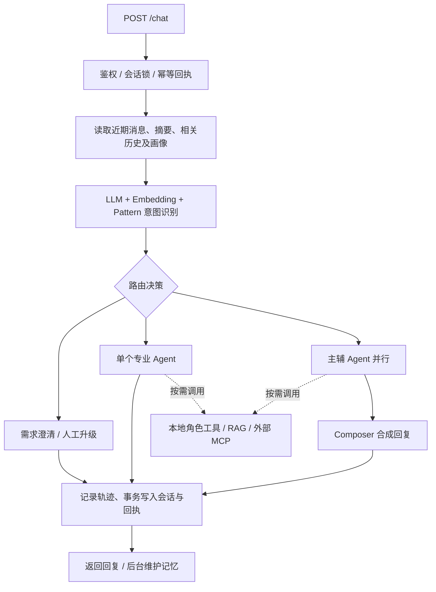

# AskNova

**面向客户支持的多智能体知识问答助手**

Python 3.12 · FastAPI · Redis · ChromaDB · MCP · Multi-Agent · Hybrid RAG

AskNova 面向订单咨询、账单售后与技术排障，把意图识别、专业 Agent 路由、工具调用、混合检索和分层记忆组织成一条可追踪的对话链路。面对“支付后无法登录，同时出现重复扣款”这类复合问题，系统可并行执行技术与账单 Agent，再合成一条回复。

本仓库抽取核心 Python 后端、业务 Skills 和回归测试，便于阅读关键实现并运行本地演示。配套前端、Java 服务、历史运行数据及简历材料不在本仓库中。

## 核心能力

| 能力 | 实现 |
|---|---|
| 细粒度意图识别 | LLM Few-shot、Embedding 相似度及 Pattern 规则加权融合，输出意图、实体、紧急度与来源分数。 |
| Multi-Agent 编排 | General、Technical、Billing、Escalation 分工；复合问题主辅并行、Composer 合成，失败回退与人工升级信息生成。 |
| 混合 RAG | 查询改写 → 向量与 BM25 并行召回 → RRF 融合 → 合并去重 → 可选 LLM 重排。 |
| MCP 扩展 | 外部工具发现、白名单及角色过滤；本地知识库通过标准 MCP 工具开放。 |
| 动态 Skills | 从 Markdown/JSON 加载业务规则，按角色及关键词匹配后注入 System Prompt。 |
| 分层记忆 | Redis 保存近期消息、摘要与会话状态，ChromaDB 保存情景摘要和用户画像；支持会话锁与幂等回执。 |
| 可靠性与追踪 | 工具缓存、超时、熔断、监控降权与恢复；请求级工具轨迹和 Prometheus 指标。 |
| 自动化评测 | 意图标签校验、LLM-as-a-Judge 四维评分、相同评测集与评分配置下的基线回归检测。 |

## 请求如何处理



Agent 根据工具描述决定是否检索知识库。程序负责参数校验、权限检查和实际执行；MCP 负责外部工具通信。角色分工由编排器组织，Agent 之间通过结构化请求与合成流程协作。

## 从哪里开始读代码

| 文件 | 阅读重点 |
|---|---|
| [api/main.py](api/main.py) | 组件初始化、`/chat`、知识导入、MCP 挂载与异步评测入口。 |
| [core/intent_recognizer.py](core/intent_recognizer.py) | Few-shot 提示词、三路融合、实体与紧急度识别。 |
| [agents/agent_orchestrator.py](agents/agent_orchestrator.py) | Agent Loop、角色契约、主辅路由、并行执行、回复合成与失败回退。 |
| [agents/tools.py](agents/tools.py) | Agent 工具定义、本地角色工具及共享 RAG 入口。 |
| [tooling/knowledge_base.py](tooling/knowledge_base.py) | 文档身份、切片、向量入库、BM25 索引与混合召回。 |
| [tooling/hybrid_retrieval.py](tooling/hybrid_retrieval.py) | 中文片段分词、BM25 倒排索引及 RRF 融合公式。 |
| [tooling/tool_manager.py](tooling/tool_manager.py) | 查询改写、去重、重排、缓存、超时与熔断。 |
| [tooling/mcp_client.py](tooling/mcp_client.py) / [mcp_server.py](tooling/mcp_server.py) | 标准 MCP 工具发现、适配和本地能力开放。 |
| [memory/conversation_memory.py](memory/conversation_memory.py) | Redis 会话事务、摘要压缩、情景检索及画像维护。 |
| [evaluation/evaluator.py](evaluation/evaluator.py) | 编排链路评测、四维 Judge 与基线对比。 |

详细流程见 [架构与设计说明](docs/architecture.md)，运行和接口示例见下文。

## 本地运行

准备 Docker Compose，以及支持 **Anthropic Messages 协议和 Tool Calling** 的模型服务。模型服务地址、模型 ID 和 Key 需由使用者自行配置。

```bash
git clone https://github.com/wenjiahaoyeah-dot/AskNova.git
cd AskNova
cp .env.example .env
```

编辑 `.env` 中的 `ANTHROPIC_API_KEY`、`ANTHROPIC_MODEL`，使用兼容服务时再设置 `ANTHROPIC_BASE_URL`。然后启动：

```bash
docker compose up -d --build
docker compose logs -f asknova
```

- API 文档：`http://localhost:8000/docs`
- 健康检查：`http://localhost:8000/health`
- Prometheus 指标：`http://localhost:8000/metrics`
- 标准 MCP 入口：`http://localhost:8000/mcp/`

首次向量化可能下载 Chroma 默认 ONNX Embedding 模型，需要网络。示例为仅绑定本机地址的开发部署；Chroma 启动未完成时，可在就绪后重启应用：`docker compose restart asknova`。

默认关闭外部 MCP，意图 Embedding 使用本地 n-gram 回退。要启用已配置的 Microsoft Learn 文档检索，将 `MCP_EXTERNAL_ENABLED` 改为 `true`；工具白名单和适用角色见 [配置文件](config/mcp_servers.json)。知识库向量使用 Chroma 客户端默认模型，与意图识别的可选在线 BGE-M3 分支分开配置。

如需在本地 Python 中运行：

```bash
python3.12 -m venv .venv
source .venv/bin/activate
python -m pip install -r requirements.txt
docker compose up -d redis chromadb
python -m uvicorn api.main:app --host 127.0.0.1 --port 8000
```

### 导入知识与对话

开发模式启动空库时会加载演示政策；要使用自己的资料，可设 `ASKNOVA_SEED_DEMO_DOCS=false`，再导入真实业务文档。关闭该开关不会删除已经入库的演示数据。

```bash
curl -X POST http://localhost:8000/knowledge/add \
  -H 'Content-Type: application/json' \
  -d '{"documents":[{"document_id":"refund-policy","title":"退款政策","content":"示例：退款申请需要提供订单号、支付时间与支付渠道，实际处理须人工核验。"}]}'

curl -X POST http://localhost:8000/chat \
  -H 'Content-Type: application/json' \
  -d '{"user_id":"demo-user","conv_id":"demo-session","client_request_id":"turn-001","message":"支付后无法登录，而且似乎扣了两次款，应该怎么处理？"}'
```

`/knowledge/upload` 支持 TXT、Markdown 和 JSON。`/search?query=退款流程&top_k=5` 使用 POST，可单独观察检索结果中的 `retrieval_sources`、`bm25_score`、`vector_score` 与 `rrf_score`。`score` 为 RRF 排名分数，不是置信概率。

可用响应中的 `request_id` 查询 `/trace/tool/{request_id}`，查看工具参数、成功状态、耗时、缓存命中和重排信息。

### 评测与监控

```bash
# 提交评测；会调用模型并产生费用。返回 job_id 后查询任务状态。
curl -X POST http://localhost:8000/eval/run \
  -H 'Content-Type: application/json' -d '{}'

# 使用上一步返回的 job_id
curl http://localhost:8000/eval/jobs/YOUR_JOB_ID

# 可选：启动本地 Prometheus
docker compose --profile monitoring up -d prometheus
```

LLM-as-a-Judge 评价相关性、准确性、完整性与有用性；意图准确率按标签匹配单独计算。评测范围是 Orchestrator 链路，不包含真实 HTTP 和完整持久化记忆回路。仓库不把历史或未复现实验数字作为当前版本效果；混合检索的 Recall/MRR 应在标注检索集上另行测量。

## 测试

```bash
python -m pip install -r requirements-dev.txt
python -m pytest tests -q
```

回归测试使用模型模拟响应、Redis 协议模拟器或本地 MCP 测试服务；无需真实模型 Key 或线上业务账号。测试不等同于真实模型、真实 Chroma 服务或 Docker 的完整联调。

混合检索还提供只用 Python 标准库即可执行的离线检查：

```bash
python -m unittest discover -s tests -p test_hybrid_retrieval.py -v
```

本轮导出已通过 16 项混合检索与 4 项文档导入离线回归。范围与未验证项目见 [检查记录](docs/verification.md)。

## 当前范围

- 订单、账单工具提供信息收集、字段检查和金额差值计算；实际订单查询、退款、发票修改和工单创建需要接入业务系统。
- 人工升级生成交接信息与后续指引，当前没有人工队列连接。
- 意图融合使用固定配置权重；在线表现反馈用于 Agent 评分、降权与恢复。
- BM25 是进程内索引，适合当前中小规模知识库；中文使用字符与双字片段。资料更新会失效索引与当前进程查询缓存。
- 外部部署应设置 `ASKNOVA_ENV=production`、独立随机 API Token 及相应网关策略。示例 Prometheus 配置用于本地开发，启用鉴权后需为采集配置匹配的认证信息。
